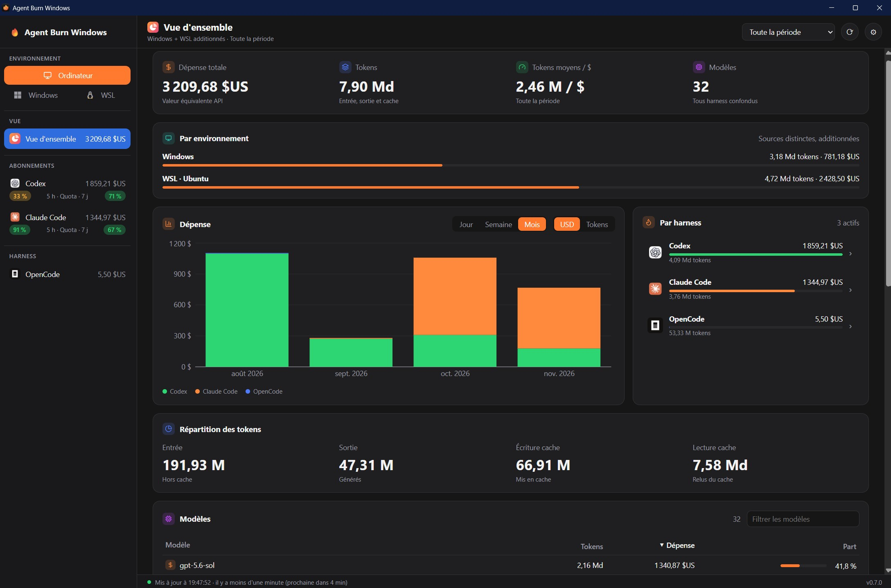

# Agent Burn for Windows

A Windows desktop app for [Agent Burn](https://github.com/Melvynx/agent-burn), Melvynx's usage
tracker for coding agents. It shows the usage, API-equivalent costs and subscription quotas of
Claude Code, Codex, OpenCode and the other harnesses its CLI reads, for native Windows, for WSL
(optional) and for both together. It can stay in the notification area with the quota left on its
icon.

## Download

Get the installer from the [latest release](https://github.com/scarlabeboy/agent-burn-windows-wsl/releases/latest).
It runs on Windows 10 and Windows 11 (64-bit) and updates itself from the app.

The installer is not code-signed, so Windows SmartScreen or an antivirus may warn about it. What
the app reads, contacts, writes and starts on your PC is listed in
[For testers](desktop/README.md#for-testers).

## More

- [The Windows app](desktop/README.md): screenshots, settings, how it builds and releases, known
  limitations. Its changes are in [the changelog](desktop/CHANGELOG.md).
- [The Agent Burn CLI](apps/agent-burn/README.md): Melvynx's command-line tool, which the app runs
  to read the logs.

Thanks to Melvynx for Agent Burn, and to David for [his Windows fork](https://github.com/DavidSZD/agent-burn),
where some of the ideas come from.
